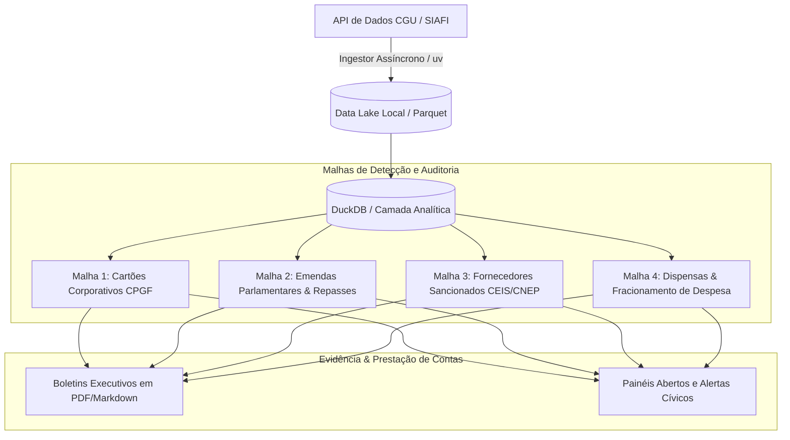

# VigiaGov — Auditoria Cívica dos Gastos Federais Brasileiros

[](https://www.python.org/downloads/)
[](https://github.com/astral-sh/uv)
[](https://duckdb.org/)
[](LICENSE)

> **"A luz do sol é o melhor dos desinfetantes."** — Louis Brandeis

O **VigiaGov** é uma iniciativa independente e aberta de controle social e fiscalização orçamentária do Governo Federal do Brasil. O projeto coleta, processa e cruza dados oficiais disponibilizados pela Controladoria-Geral da União (CGU) e pelo Sistema Integrado de Administração Financeira (SIAFI), transformando milhões de registros contábeis herméticos em **evidências matemáticas, alertas de desvio e visualizações cívicas claras**.

Este projeto não tem bandeira partidária nem finalidade comercial. Nasce do dever cidadão de fiscalizar o uso do dinheiro público e expor com rigor técnico os desvios, privilégios corporativos, emendas sem lastro e o mau uso do patrimônio da nação.

---

## 🎯 As 4 Malhas de Fiscalização Cívica



1. **Malha CPGF (Cartão de Pagamento do Governo Federal):** Fiscalização de gastos diários, saques vultosos em espécie na boca do caixa, fracionamento artificial de compras para fuga de licitação e fornecedores repetidos em gastos sigilosos.
2. **Malha Emendas:** Acompanhamento do destino final das emendas parlamentares (individuais, comissão e transferência especial / emendas PIX), calculando desvios per capita por município e cruzando com doadores de campanha.
3. **Malha Sancionados (CEIS / CNEP / CEPIM):** Cruzamento automático para garantir que empresas declaradas inidôneas, suspensas ou punidas pela Justiça e tribunais de contas não continuem operando ou recebendo empenhos de forma indireta.
4. **Malha Fracionamento & Emergenciais:** Identificação de compras no mesmo CNPJ em datas contíguas na mesma unidade gestora cujos somatórios ultrapassam o limite legal de dispensa de licitação.

---

## 🛠️ Stack Tecnológica

O projeto adota uma arquitetura soberana, de baixíssimo custo de infraestrutura e execução local reproduzível:
- **Gerenciador de Dependências:** [`uv`](https://github.com/astral-sh/uv) (Astral) para isolamento estrito e velocidade extrema.
- **Motor Analítico:** [DuckDB](https://duckdb.org/) para processamento de alto desempenho de arquivos colunares Parquet sem necessidade de servidores de banco pesados.
- **Cliente HTTP:** `httpx` assíncrono com rate limiting de respeito às diretrizes da CGU e retries com backoff exponencial.
- **Auditabilidade:** Todo alerta ou dado consolidado mantém o identificador primário do Portal da Transparência (Nota de Empenho, Ordem Bancária, CNPJ e Favorecido).

---

## 🚀 Como Executar

### 1. Pré-requisitos
Tenha o gerenciador `uv` instalado na máquina:
```bash
# Windows (PowerShell)
powershell -ExecutionPolicy ByPass -c "irm https://astral.sh/uv/install.ps1 | iex"

# Linux / macOS
curl -LsSf https://astral.sh/uv/install.sh | sh
```

### 2. Configurar a Chave da API
Obtenha uma chave gratuita no [Portal da Transparência do Governo Federal](https://portaldatransparencia.gov.br/api-de-dados/cadastrar).
Crie o arquivo `.env` a partir do modelo:
```bash
cp .env.example .env
```
Edite o `.env` e preencha:
```ini
CGU_API_KEY=sua_chave_aqui
```

### 3. Rodar o Healthcheck Inicial
```bash
uv run vigiagov check
```

---

## ⚖️ Princípios e Governança

1. **Fidelidade ao Dado Original:** O VigiaGov não inventa, estima ou interpola números. Todo número publicado tem como lastro a API oficial do Portal da Transparência da CGU.
2. **Código Aberto e Auditável:** Todo algoritmo de detecção de desvio é público e pode ser inspecionado por qualquer cidadão, jornalista ou órgão de controle.
3. **Independência Política:** O rigor das malhas de auditoria é rigorosamente o mesmo para qualquer esfera de poder, ministério, partido ou parlamentar.

---

## 📄 Licença
Distribuído sob licença MIT. Veja `LICENSE` para mais detalhes.
